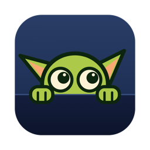
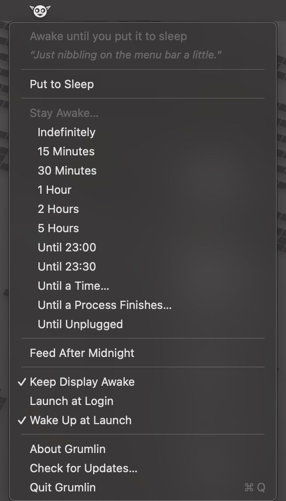

<p align="center"></p>

<h1 align="center">Grumlin</h1>

<p align="center">A tiny gremlin in your menu bar that keeps your Mac awake.<br>
Bites if poked. Don't feed it after midnight.</p>

<p align="center"><a href="https://github.com/ffeaturesque/grumlin/releases/latest"><b>Download the latest version</b></a></p>

<p align="center"></p>

Click Grumlin to keep your Mac awake. Click again when you’re done. Right-click to set a timer or have it keep watch until a process finishes or you unplug your laptop. If you want the screen to sleep while your Mac keeps working, uncheck **Keep Display Awake**.

On long shifts, Grumlin sometimes nods off. Move the pointer over it and it’ll swear it was awake.

## Install

Download the DMG, open it, and drag Grumlin into Applications. You’ll need macOS 13 Ventura or later, on Apple Silicon or Intel. [Download Grumlin](https://github.com/ffeaturesque/grumlin/releases/latest)

If you use Homebrew, this installs both the app and the terminal command.

```sh
brew install --cask ffeaturesque/tap/grumlin
```

## From the terminal

Put `grumlin` in front of a command to keep your Mac awake while it runs.

```sh
grumlin make -j8
```

When the build finishes, Grumlin goes back to sleep. If you installed the app from the DMG, right-click Grumlin and choose **Until a Process Finishes… → Install grumlin Command…** to enable the command.

Made by featuresque.
